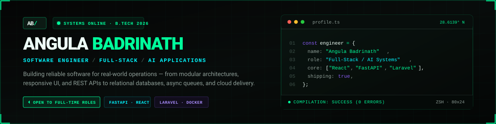
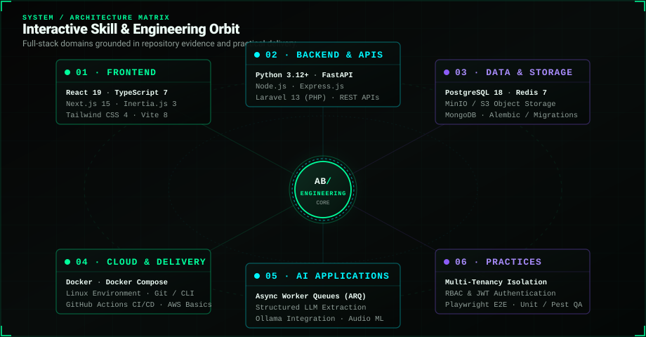
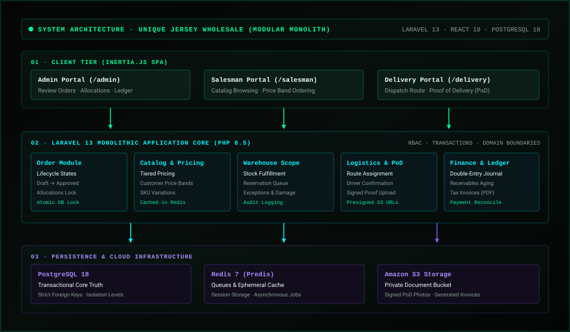
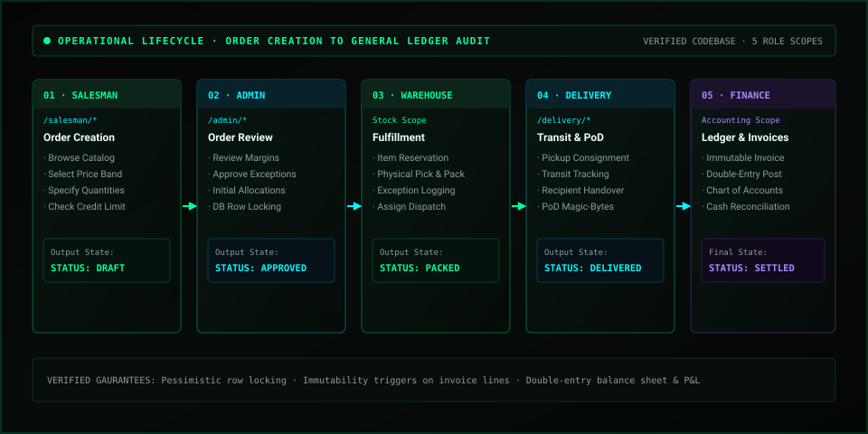
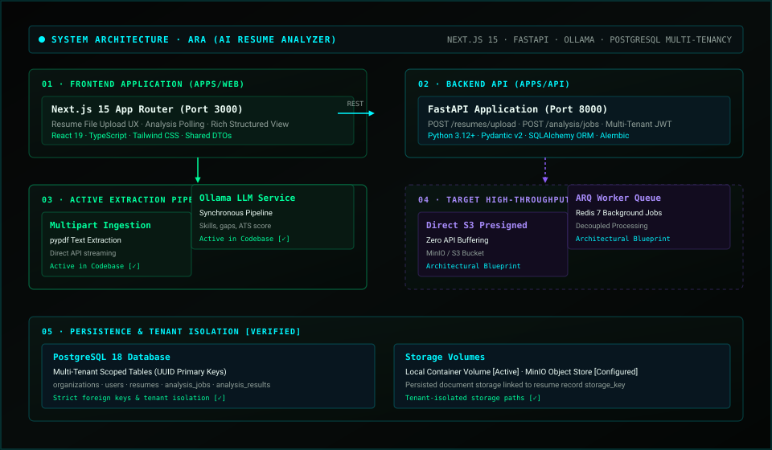
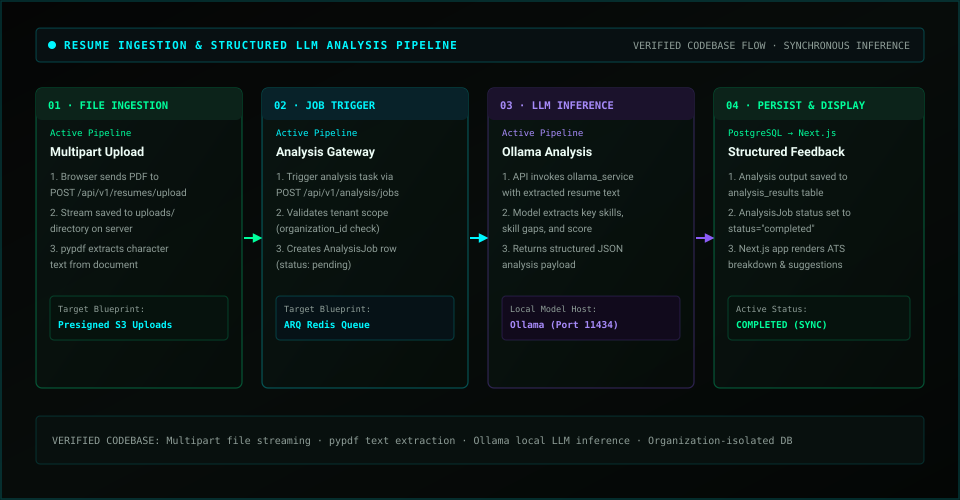
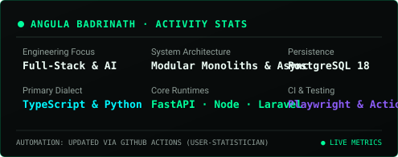

<div align="center">

  

  <p align="center">
    <a href="https://angulabadrinath.vercel.app/">
      
    </a>
    <a href="https://www.linkedin.com/in/angulabadrinath/">
      
    </a>
    <a href="https://github.com/AngulaBadrinath">
      
    </a>
    <a href="mailto:badrinathonly1@gmail.com">
      
    </a>
    
  </p>

  <p align="center">
    <a href="#about">About</a> &nbsp;·&nbsp;
    <a href="#skills">Skills</a> &nbsp;·&nbsp;
    <a href="#selected-work">Selected Work</a> &nbsp;·&nbsp;
    <a href="#architecture">Architecture</a> &nbsp;·&nbsp;
    <a href="#activity">Activity</a> &nbsp;·&nbsp;
    <a href="#experience">Experience</a> &nbsp;·&nbsp;
    <a href="#contact">Contact</a>
  </p>

</div>

---

## About

I am **Angula Badrinath**, a **2026 B.Tech graduate** and software engineer focused on building robust, production-oriented systems.

I work across the full engineering lifecycle: translating domain requirements into clean application architecture, crafting responsive web interfaces, designing resilient RESTful APIs, structuring relational and cache data layers, orchestrating background worker queues, and hardening deployments through automated testing and CI/CD pipelines.

My primary technical instincts lie in **TypeScript/React**, **Python/FastAPI**, **Laravel/PHP**, and **PostgreSQL/Redis**. I value explicit system boundaries, transactional data integrity, and pragmatic engineering that solves real operational bottlenecks.

---

## Skills

<div align="center">
  
</div>

<br />

The interactive orbit above outlines six core engineering domains grounded in hands-on repository code and client delivery work. Expand each section below to inspect specific technologies, implementation contexts, and proficiency tiers:

<details>
  <summary><b>01 · Frontend Engineering</b> (React 19, TypeScript, Next.js 15, Inertia.js 3, Tailwind CSS)</summary>
  <br />

  - **Hands-on Project Use:** React 19, TypeScript 7, Next.js 15 (App Router), Inertia.js 3, Tailwind CSS 4, Vite 8, shadcn/ui.
  - **Working Familiarity:** Vue.js, D3.js data visualizations, state management, HTML5 Canvas, WebSockets.
  - **Core Implementation Evidence:**
    - High-performance, single-page application experience in [Unique-Distributors](https://github.com/AngulaBadrinath/Unique-Distributors) with Inertia.js 3, TypeScript strict typing, and Tailwind CSS 4.
    - Drag-and-drop file ingestion, client-side validation, and asynchronous status polling in [ARA](https://github.com/AngulaBadrinath/ARA) (`apps/web`).
    - Terminal-themed, accessible portfolio interface with responsive layout at [angulabadrinath.vercel.app](https://angulabadrinath.vercel.app/).
</details>

<details>
  <summary><b>02 · Backend &amp; APIs</b> (Python, FastAPI, Node.js, Laravel 13, RESTful APIs)</summary>
  <br />

  - **Hands-on Project Use:** Python 3.12+, FastAPI, Node.js, Express.js, Laravel 13, PHP 8.3/8.5, REST API design, Pydantic v2.
  - **Working Familiarity:** Alembic database migrations, SQLAlchemy ORM, JWT authentication, Eloquent ORM, middleware design.
  - **Core Implementation Evidence:**
    - Modular monolith core in [Unique-Distributors](https://github.com/AngulaBadrinath/Unique-Distributors) with strict domain modules, transactional locks, and role-based route middleware.
    - Asynchronous RESTful service in [ARA](https://github.com/AngulaBadrinath/ARA) (`apps/api`) using FastAPI with Pydantic schemas, dependency injection, and non-blocking job dispatching.
    - Automated business utilities and data pipelines built during ~3 months at Programmica.
</details>

<details>
  <summary><b>03 · Data &amp; Storage</b> (PostgreSQL 18, Redis 7, MinIO / S3, MongoDB)</summary>
  <br />

  - **Hands-on Project Use:** PostgreSQL 18, Redis 7 (Predis / aioredis), MinIO / Amazon S3 object storage with presigned URLs.
  - **Working Familiarity:** MongoDB, MySQL, database normalization, indexing strategies, double-entry financial ledger schema.
  - **Core Implementation Evidence:**
    - Transactional state machine and inventory allocations with atomic database constraints in [Unique-Distributors](https://github.com/AngulaBadrinath/Unique-Distributors).
    - Multi-tenant tenant-isolation schema (`organization_id` foreign keys, UUID primary keys) and direct browser-to-S3 presigned upload pipeline in [ARA](https://github.com/AngulaBadrinath/ARA).
</details>

<details>
  <summary><b>04 · Cloud &amp; Delivery</b> (Docker, Linux, AWS, GitHub Actions, CI/CD)</summary>
  <br />

  - **Hands-on Project Use:** Docker, Docker Compose, Linux CLI / bash scripting, Git, GitHub Actions, Vite build optimization.
  - **Working Familiarity:** AWS EC2, AWS RDS, AWS Route 53, Amazon S3, Sentry observability, Nginx.
  - **Core Implementation Evidence:**
    - Multi-container local orchestration (PostgreSQL 18, Redis 7, web application) and automated CI workflows in [Unique-Distributors](https://github.com/AngulaBadrinath/Unique-Distributors).
    - Monorepo containerization (API, Web, Worker, DB, MinIO) in [ARA](https://github.com/AngulaBadrinath/ARA).
    - Pinned, least-privilege GitHub Actions workflows for automated profile metrics and asset generation in this repository.
</details>

<details>
  <summary><b>05 · AI Applications &amp; Async Systems</b> (ARQ Worker Queues, LLM Pipelines, Local Models)</summary>
  <br />

  - **Hands-on Project Use:** ARQ asynchronous background workers, structured JSON schema extraction with LLMs, prompt engineering.
  - **Working Familiarity:** Local LLM hosting (Ollama), provider-agnostic model abstraction, audio processing (PyAudio, SpeechRecognition).
  - **Core Implementation Evidence:**
    - Background resume processing pipeline in [ARA](https://github.com/AngulaBadrinath/ARA) decoupling the web request cycle from heavy LLM text extraction.
    - Desktop voice capture and translation experiments in [RealTime-VoiceTranslator](https://github.com/AngulaBadrinath/RealTime-VoiceTranslator).
</details>

<details>
  <summary><b>06 · Engineering Practices &amp; Quality</b> (Multi-Tenancy, RBAC, Playwright, Pest)</summary>
  <br />

  - **Hands-on Project Use:** Role-Based Access Control (RBAC), multi-tenant data boundaries, Playwright E2E testing, Pest/PHPUnit test harnesses.
  - **Working Familiarity:** Static analysis (`tsc --noEmit`), code reviews, semantic versioning, zero-trust presigned upload architecture.
  - **Core Implementation Evidence:**
    - Browser test suite and static type-checking integration in [Unique-Distributors](https://github.com/AngulaBadrinath/Unique-Distributors).
    - Separation of concerns across API routers, service layers, repositories, and worker tasks in [ARA](https://github.com/AngulaBadrinath/ARA).
</details>

---

## Selected Work

### 01 · Wholesale Distribution Management System (Unique Jersey Wholesale)
**Enterprise B2B Distribution & ERP Platform** · *Modular Monolith Architecture*

> Public Repository: [AngulaBadrinath/Unique-Distributors](https://github.com/AngulaBadrinath/Unique-Distributors) · **Status:** Active Open-Source Architecture & Client Delivery Foundation

```text
Stack: Laravel 13 · PHP 8.5 · React 19 · TypeScript 7 · Inertia.js 3 · Tailwind CSS 4 · PostgreSQL 18 · Redis 7 · Docker · Playwright
```

- **Problem:** Wholesale distributors handle high-volume B2B orders with negotiated customer price bands, inventory volatility, credit limits, and delivery tracking that off-the-shelf software fails to coordinate without error-prone spreadsheets.
- **Solution & Architecture:** Engineered a modular monolith around a single shared transactional core in Laravel 13 and PostgreSQL 18, fronted by an Inertia.js React 19 SPA. Configured five isolated operational scopes:
  1. *Admin Portal* (`/admin/*`): Pricing exceptions, margin review, credit approvals, and warehouse adjustments.
  2. *Salesman Portal* (`/salesman/*`): Mobile-first field sales tool for customer catalog browsing, bounded price band selection, and draft order creation.
  3. *Delivery Partner Portal* (`/delivery/*`): Task-oriented dispatch routes, recipient sign-off, and photographic Proof of Delivery (PoD) uploads.
  4. *Warehouse Scope*: Real-time stock reservation, physical discrepancy logging, and pick-and-pack fulfillment.
  5. *Accountant Scope*: Receivables tracking, double-entry ledger postings, and automated PDF tax invoices.
- **Engineering Highlights:** Atomic database locks on stock reservation to eliminate overselling; private Amazon S3 document bucket for presigned proof uploads; Playwright end-to-end browser test harness and PHPUnit/Pest test coverage.
- [Jump to Architecture Diagram & Source](#unique-jersey-wholesale-modular-monolith-architecture) · [Jump to Workflow Diagram](#unique-jersey-wholesale-operational-lifecycle-workflow)

---

### 02 · ARA — AI Resume Analyzer
**Multi-Tenant Resume Intelligence Platform** · *Asynchronous Worker Architecture*

> Public Repository: [AngulaBadrinath/ARA](https://github.com/AngulaBadrinath/ARA) · **Status:** Active Architectural Implementation & Monorepo

```text
Stack: Next.js 15 (App Router) · FastAPI · Python 3.12+ · PostgreSQL 18 · Redis 7 · MinIO / S3 · ARQ Worker · Ollama LLM · Docker Compose
```

- **Problem:** Synchronous AI parsing of multi-page resumes causes high latency, request timeouts, and server memory exhaustion during document extraction and LLM inference.
- **Solution & Architecture:** Architected a decoupled, asynchronous multi-tenant system with clear domain boundaries:
  - *Direct S3 Upload:* Browser requests a short-lived presigned upload URL from FastAPI and uploads resumes directly to MinIO/S3, eliminating file-buffering load on the API gateway.
  - *Async Job Dispatch:* FastAPI validates metadata, generates a pending job record scoped to the tenant's `organization_id`, and enqueues the task into Redis.
  - *Worker Execution:* An independent ARQ background worker dequeues the job, retrieves the document binary from S3, extracts text, and invokes a provider-agnostic LLM interface (supporting local Ollama or cloud models).
  - *Structured Persistence:* The worker stores structured JSON (detected skills, gap analysis, ATS score, and targeted recommendations) into PostgreSQL and marks the job completed for client polling.
- **Engineering Highlights:** Strict multi-tenant data isolation; zero API file buffering; provider-agnostic LLM interface abstraction (`app/llm`); full Docker Compose local infrastructure.
- [Jump to Architecture Diagram & Source](#ara-multi-tenant-asynchronous-architecture) · [Jump to Pipeline Workflow](#ara-resume-analysis-pipeline-workflow)

---

### 03 · Universal Wholesale Application
**Client-Delivered Wholesale Commerce Workflow** · *Case Study (Private Client Delivery)*

```text
Stack: Full-Stack Web Architecture · REST APIs · Relational Database · Authentication · Cloud Hosting
```

- **Problem:** A regional wholesale distributor required a private digital platform to replace manual phone/message ordering, synchronize wholesale catalog pricing, and track account-level order fulfillment.
- **Delivered Solution:** Shipped an end-to-end wholesale ordering portal supporting dynamic B2B product catalogs, bulk cart mechanics, tiered wholesale price calculation, order tracking, and authenticated administrative workflows.
- *Note:* In accordance with client confidentiality agreements, customer proprietary data, production domains, and source repositories are kept private.

---

### Supporting & Exploratory Projects

- **LinguaSync — Real-Time Voice Translator:** Desktop audio capture and cross-lingual translation application exploring speech recognition pipelines, microphone stream processing, and translation services.  
  `Python · PyAudio · SpeechRecognition · gTTS` · [Repository (Learning & Adaptation)](https://github.com/AngulaBadrinath/RealTime-VoiceTranslator)

---

## Architecture

Deep technical architectural blueprints and execution sequences for featured systems. Editable Mermaid diagrams are version-controlled in [`assets/diagrams/source/`](./assets/diagrams/source/).

### Unique Jersey Wholesale — Modular Monolith Architecture

<div align="center">
  
</div>

<details>
  <summary><b>Inspect Architectural Details &amp; Mermaid Source</b></summary>
  <br />

  ```text
  Pattern: Modular Monolith with Shared Transactional Core
  Layers:
    1. Client Tier: Inertia.js 3 single-page apps (React 19 + TypeScript) tailored for Admin, Salesman, and Delivery.
    2. Core Monolith: Laravel 13 (PHP 8.5) coordinating domain modules (Orders, Catalog, Inventory, Dispatch, Finance).
    3. Persistence: PostgreSQL 18 for authoritative transactional state, Redis 7 for cache and queue broker.
    4. Object Storage: Amazon S3 with short-lived presigned URLs for delivery proof and invoices.
  ```

  Editable diagram source: [`assets/diagrams/source/ujw-architecture.mmd`](./assets/diagrams/source/ujw-architecture.mmd)
</details>

---

### Unique Jersey Wholesale — Operational Lifecycle Workflow

<div align="center">
  
</div>

<details>
  <summary><b>Inspect State Machine &amp; Mermaid Source</b></summary>
  <br />

  ```text
  State Machine Sequence:
    Draft (Salesman Order)
      ↳ Approved (Admin Margin & Credit Review)
        ↳ Packed (Warehouse Stock Reservation & Discrepancy Check)
          ↳ Delivered (Driver Handover & Signed PoD Upload to S3)
            ↳ Settled (Accountant Double-Entry Ledger Posting & Tax Invoice)
  ```

  Editable diagram source: [`assets/diagrams/source/ujw-workflow.mmd`](./assets/diagrams/source/ujw-workflow.mmd)
</details>

---

### ARA — Multi-Tenant Asynchronous Architecture

<div align="center">
  
</div>

<details>
  <summary><b>Inspect Tier Boundaries &amp; Mermaid Source</b></summary>
  <br />

  ```text
  Pattern: Decoupled Multi-Tenant Asynchronous Processing Monorepo
  Tiers:
    1. Frontend (apps/web): Next.js 15 App Router handling UI and direct presigned S3 uploads.
    2. API Gateway (apps/api): FastAPI with Pydantic v2 schemas and JWT tenant-scoped authorization.
    3. Async Queue & Workers: Redis 7 message broker with independent ARQ worker processes.
    4. AI Engine: Provider-agnostic LLM interface (app/llm) supporting local Ollama or cloud models.
    5. Persistence: PostgreSQL 18 with tenant-scoped tables and MinIO/S3 object storage.
  ```

  Editable diagram source: [`assets/diagrams/source/ara-architecture.mmd`](./assets/diagrams/source/ara-architecture.mmd)
</details>

---

### ARA — Resume Analysis Pipeline Workflow

<div align="center">
  
</div>

<details>
  <summary><b>Inspect Asynchronous Pipeline Flow &amp; Mermaid Source</b></summary>
  <br />

  ```text
  Pipeline Flow:
    1. Client requests presigned upload URL from FastAPI.
    2. Browser uploads document directly to MinIO/S3 (zero API file buffering).
    3. Client confirms upload; API inserts resume record and enqueues task in Redis.
    4. ARQ Worker dequeues task, extracts text, calls LLM via structured schema.
    5. Structured results persisted to PostgreSQL; job marked completed for client display.
  ```

  Editable diagram source: [`assets/diagrams/source/ara-analysis-workflow.mmd`](./assets/diagrams/source/ara-analysis-workflow.mmd)
</details>

---

## Activity

Real-world development telemetry and repository activity generated automatically through self-hosted GitHub Actions workflows:

<div align="center">

  

  <br /><br />

  

</div>

<details>
  <summary><b>Telemetry &amp; Automation Architecture Notes</b></summary>
  <br />

  - **Metrics Engine:** Automated via [`cicirello/user-statistician`](https://github.com/cicirello/user-statistician) pinned to verified SHA `36500351ea14b69e68217d4c89eb0f3f06680b17`.
  - **Contribution Animation:** Automated via [`Platane/snk`](https://github.com/Platane/snk) pinned to verified SHA `d8f6715049803e982ee5ff501b6b9b7d5deeb09b`.
  - **Security &amp; Permissions:** Least-privilege `contents: write` scoped strictly to generation jobs with idempotency checks to prevent redundant empty commits.
  - **Schedule:** Refreshed daily via cron and manual dispatch in [`.github/workflows/`](./.github/workflows/).
</details>

---

## Experience

### Professional Experience
- **Python Developer Intern · Programmica**  
  *Dec 2024 — Feb 2025 (~3 months)*
  - Developed automation utilities and backend Python business logic for third-party API integrations and structured data processing.
  - Implemented unit validations, handled edge-case exceptions, and contributed to internal backend reliability.

### Client Project Delivery
- **Universal Wholesale & Unique Jersey Wholesale**  
  *Full-Stack Application Development & Architecture*
  - Engineered production workflows for B2B wholesale distribution, including product catalogs, pricing tiers, order approval state machines, and inventory tracking.
  - Hardened full-stack codebases through Docker containerization, database indexing, and Playwright end-to-end testing.

### Current Engineering Focus
- **Distributed Architecture:** Designing scalable asynchronous queue systems and modular monolith patterns.
- **AI Application Integration:** Implementing provider-agnostic LLM extraction pipelines, structured output validation, and local model deployment with Ollama.
- **DevOps & Reliability:** Deepening CI/CD automation, Docker orchestration, and cloud infrastructure on AWS.

---

## Contact

I am open to full-time engineering opportunities across:
- **Full-Stack / MERN Developer**
- **React / Frontend Developer**
- **Node.js / Python Backend Developer**
- **Associate Software Engineer**
- **AI Application Developer**

I am open to **onsite**, **hybrid**, and **remote** roles in India, and willing to relocate for the right opportunity.

<div align="center">

  <p>
    <a href="mailto:badrinathonly1@gmail.com">
      
    </a>
    &nbsp;
    <a href="https://www.linkedin.com/in/angulabadrinath/">
      
    </a>
    &nbsp;
    <a href="https://angulabadrinath.vercel.app/">
      
    </a>
  </p>

  <p>
    <i>Build with intent. Design for reliability. Ship with care.</i>
  </p>

</div>
